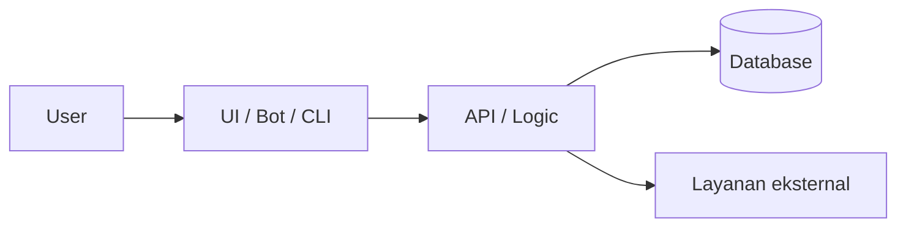

# Arsitektur — {{NAMA_PRODUK}}

> **Status:** draft · **Pemilik:** {{PEMILIK}} · **Terakhir diperbarui:** {{TANGGAL}}

## 1. Ringkasan solusi

Jelaskan dalam 3–5 kalimat: bentuk aplikasi, komponen utama, dan bagaimana data mengalir.

## 2. Stack dan alasan

| Lapisan | Pilihan | Alasan | Alternatif yang ditolak |
|---|---|---|---|
| Bahasa |  |  |  |
| Frontend |  |  |  |
| Backend |  |  |  |
| Database |  |  |  |
| Auth |  |  |  |
| Hosting |  |  |  |
| Testing |  |  |  |
| Observability |  |  |  |

## 3. Diagram alur



Jika diagram tidak bisa dirender, jelaskan alurnya sebagai daftar bernomor.

## 4. Model data

| Entitas | Field penting | Relasi | Retensi | Catatan |
|---|---|---|---|---|
|  |  |  |  |  |

**Aturan data:**
- Constraint penting:
- Data unik:
- Data yang dihapus:
- Data pribadi:
- Backup:

## 5. API / interface

| Aksi / Endpoint | Input | Output | Auth | Error yang mungkin |
|---|---|---|---|---|
|  |  |  |  |  |

**Kontrak umum:**
- Format error:
- Pagination:
- Idempotency:
- Rate limit:
- Timeout:

## 6. Struktur folder

```text
.
├── src/
├── tests/
├── docs/
└── ...
```

Jelaskan tanggung jawab setiap folder utama.

## 7. Auth, peran, dan izin

| Peran | Bisa melihat | Bisa mengubah | Catatan |
|---|---|---|---|
|  |  |  |  |

- Siapa yang boleh mendaftar?
- Bagaimana reset password?
- Apakah ada akses admin?
- Apakah otorisasi diperiksa di server?

## 8. Keamanan dan privasi

- **Data sensitif:**
- **Enkripsi saat transit/diam:**
- **Validasi input:**
- **Secrets:**
- **Logging:**
- **Kepatuhan/kebijakan:**
- **Risiko utama:**

### Threat model ringan

**Aset yang dilindungi:** (data user, uang, akun admin, reputasi, …)
**Batas kepercayaan:** (di mana data dari luar masuk: form, API, webhook, upload, AI)

| Ancaman (STRIDE) | Skenario konkret | Mitigasi | Status |
|---|---|---|---|
| Spoofing |  |  |  |
| Tampering |  |  |  |
| Repudiation |  |  |  |
| Information disclosure |  |  |  |
| Denial of service |  |  |  |
| Elevation of privilege |  |  |  |

## 9. Error handling, logging, dan observability

- Error yang ditangani user:
- Error yang di-log:
- Format log:
- Data yang tidak boleh masuk log:
- Health check:
- Alert:

## 10. Performa dan skalabilitas

- **Beban awal yang diperkirakan:**
- **Target performa:**
- **Bottleneck yang mungkin:**
- **Rencana jika tumbuh:**
- **Yang sengaja tidak dioptimalkan sekarang:**

## 11. Biaya

| Item | Estimasi bulanan | Batas gratis | Catatan |
|---|---|---|---|
|  |  |  |  |
| **Total** |  |  |  |

## 12. Topologi deployment

Jelaskan environment lokal, staging, dan produksi; komponen apa saja yang berjalan di masing-masing.

## 13. Keputusan teknis (ADR)

### ADR-001 — [Judul keputusan]

- **Konteks:**
- **Keputusan:**
- **Alasan:**
- **Konsekuensi:**
- **Alternatif yang ditolak:**

## 14. Risiko teknis

| Risiko | Kemungkinan | Dampak | Mitigasi |
|---|---|---|---|
|  |  |  |  |

## 15. Utang teknis yang diketahui

| Utang | Alasan ditunda | Rencana | Prioritas |
|---|---|---|---|
|  |  |  |  |
